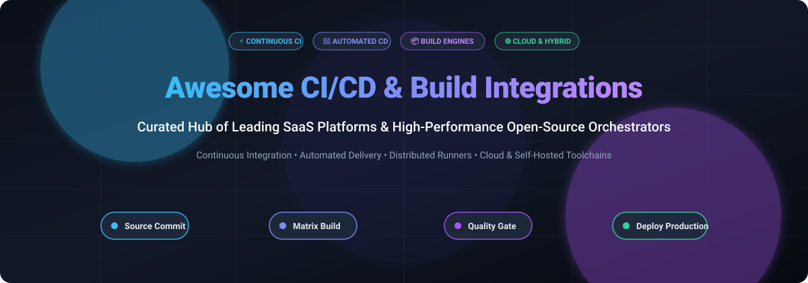

# ⚡ Awesome CI/CD Pipeline & Build Integrations 🚀

  <strong>A curated index of top-tier SaaS platforms, enterprise build orchestrators, and open-source continuous integration & delivery pipelines.</strong>

<!-- Badges Section -->

  
  
  
  
  
  

---

## 📌 Table of Contents
- [🔍 Sector Overview & Market Dynamics](#-sector-overview--market-dynamics)
- [☁️ SaaS / Hosted CI/CD Platforms](#️-saas--hosted-cicd-platforms)
- [🛠️ Open-Source CI/CD & Build Orchestration Projects](#️-open-source-cicd--build-orchestration-projects)
- [💡 Choosing the Right CI/CD Strategy](#-choosing-the-right-cicd-strategy)
- [🤝 How to Contribute](#-how-to-contribute)
- [💖 Support](#-support)
- [📈 Star History](#-star-history)
- [⚠️ Disclaimer](#️-disclaimer)

---

## 🔍 Sector Overview & Market Dynamics

The global CI/CD and continuous delivery market is valued at approximately **$5.7B to $13.2B** (with dedicated continuous integration tooling accounting for $1.7B–$2.5B), growing at a compound annual growth rate (CAGR) of 14–22% through 2026. The sector is **moderately fragmented**—while developer workflow is heavily concentrated around dominant git-integrated platforms like GitHub Actions and GitLab CI/CD, enterprises frequently run heterogeneous multi-pipeline setups, preserving durable market share for hyperscaler pipelines (AWS, Azure), specialized runners (CircleCI), and legacy self-hosted workhorses (Jenkins).

---

## ☁️ SaaS / Hosted CI/CD Platforms

The following table highlights the industry's premier commercial and managed SaaS CI/CD tools, sorted by **company size / valuation (descending)**:

| Product | 🏢 Company Size / Valuation / Revenue | 📝 Description | 💳 Pricing (Starting Tier) | 🎁 Free Tier / Free Trial Limits |
|:---|:---|:---|:---|:---|
| **[Azure Pipelines](https://azure.microsoft.com/en-us/products/devops/pipelines/)** | **~$3.1 Trillion** market cap (Microsoft) | Microsoft's enterprise CI/CD service within Azure DevOps with YAML pipelines, hosted/self-hosted agents, and deep Azure ecosystem integration. | $40/month per additional Microsoft-hosted parallel job ($15/month per extra self-hosted job) | **Free tier (forever):** 1 Microsoft-hosted job with 1,800 min/month + 1 self-hosted job with unlimited minutes; public projects get 10 free parallel jobs with unlimited minutes |
| **[AWS CodePipeline](https://aws.amazon.com/codepipeline/)** | **~$2.1 Trillion** market cap (Amazon) | Managed continuous delivery service orchestrating build, test, and deploy stages natively across AWS and third-party systems. | $1.00/active pipeline/month (V1 pipelines) or $0.002/action-execution-minute (V2 pipelines) | **AWS Free Tier (forever):** 1 free active V1 pipeline per month; 100 free action-execution minutes per month for V2 pipelines |
| **[GitHub Actions](https://github.com/features/actions)** | **~$3.1 Trillion** parent market cap (Microsoft) / **$1B+ ARR** (GitHub subsidiary) | Native CI/CD engine built right into GitHub featuring 20,000+ Marketplace actions, matrix workflows, and self-hosted runners. | $4/user/month (GitHub Team tier; public repos $0; additional private minutes from $0.008/min Linux) | **Free tier (forever):** 2,000 minutes/month for private repos (1x Linux multiplier, 10x macOS); unlimited free minutes for all public repositories |
| **[Bitbucket Pipelines](https://bitbucket.org/product/features/pipelines)** | **~$45 Billion** market cap (Atlassian) | Integrated CI/CD directly inside Bitbucket with native Jira traceability, Docker build agents, and automated test runners. | $3/user/month (Standard tier; $6/user/month for Premium) | **Free tier (forever):** 50 build minutes/month for up to 5 users, plus up to 100 free self-hosted runners per workspace |
| **[GitLab CI/CD](https://about.gitlab.com/)** | **~$8.1 Billion** market cap (NASDAQ: GTLB) | Complete single DevOps platform offering `.gitlab-ci.yml` pipeline definitions, Auto DevOps, and Kubernetes runners. | $29/user/month (GitLab Premium tier) | **Free tier (forever):** 400 compute minutes/month per namespace, up to 5 users per namespace, and unlimited self-hosted runner minutes |
| **[Postman CI Integrations](https://www.postman.com/)** | **~$5.6 Billion** valuation (~$313M ARR) | API testing and lifecycle platform with native CI integrations for automated regression suites via Newman and CLI runners. | $14/user/month (Postman Basic plan billed annually) | **Free tier (forever):** Free for 1 user, includes 3 collection runs via CLI/CI per month and limited mock server calls |
| **[Travis CI](https://www.travis-ci.com/)** | **~$3.0 Billion** parent valuation (Idera, Inc.) | Pioneer cloud CI/CD platform offering fast, containerized builds across Linux, macOS, and Windows environments. | $15/month (Usage-Based plan: 35,000 credits, up to 80 concurrent jobs) | **Free trial only:** 14-day free trial with 10,000 one-time build credits (non-renewable); open-source repos can apply for OSS credit grants |
| **[CircleCI](https://circleci.com/)** | **~$1.7 Billion** valuation (~$55M ARR) | High-speed cloud CI/CD platform featuring reusable Orbs, Docker layer caching, test splitting, and GPU/arm/macOS runners. | $15/month base (Performance plan: includes 30,000 credits, additional credits $0.0006/credit) | **Free tier (forever):** 30,000 credits/month (~3,000 Linux medium build minutes), 5 active users, 5 self-hosted runners, 1 macOS concurrency |
| **[Jenkins](https://www.jenkins.io/)** | **~$1.2 Billion** valuation / **$150M+ ARR** (CloudBees commercial sponsor) | The leading open-source automation engine with 1,800+ plugins, maintained by the CD Foundation with enterprise backing. | Free open-source core (Enterprise CloudBees CI starts from ~$10,000/year; self-hosted VM costs ~$30–$80/month) | **Free forever (100% open-source):** No hosted SaaS tier; software is 100% free under MIT license with unlimited users, builds, and nodes (infrastructure self-managed) |
| **[TeamCity](https://www.jetbrains.com/teamcity/)** | **~$700 Million** annual revenue (JetBrains) | JetBrains' powerful CI/CD engine supporting intelligent test re-ordering, matrix pipelines, and flexible agent scaling. | $54/month per extra build agent (TeamCity Cloud) or $1,999/year (TeamCity On-Premise Enterprise) | **Free tier (forever):** TeamCity Professional (on-premise) is free forever with unlimited users, 3 build agents, 100 build configurations, and 10 pipelines |

---

## 🛠️ Open-Source CI/CD & Build Orchestration Projects

Explore prominent self-hosted build servers, containerized workflow orchestrators, and pipeline acceleration engines. Sorted by **GitHub Star count (descending)**:

| Project | ⭐ Stars | 📖 Description |
|:---|:---|:---|
| **[nektos/act](https://github.com/nektos/act)** |  | Run your GitHub Actions locally inside Docker containers with fast feedback loops and zero cloud runner cost. |
| **[harness/drone](https://github.com/harness/drone)** |  | Modern container-native Continuous Integration platform written in Go, executing every build step in isolated ephemeral Docker containers. |
| **[jenkinsci/jenkins](https://github.com/jenkinsci/jenkins)** |  | The extensible open-source automation server with 1,800+ plugins supporting build, deployment, and automation for any software project. |
| **[argoproj/argo-workflows](https://github.com/argoproj/argo-workflows)** |  | Cloud-native container workflow engine for Kubernetes supporting DAG and step-based pipelines for parallel CI, compute, and machine learning. |
| **[dagger/dagger](https://github.com/dagger/dagger)** |  | Programmable CI/CD engine that lets you develop your build, test, and release pipelines as code in Python, TypeScript, or Go and run them anywhere. |
| **[earthly/earthly](https://github.com/earthly/earthly)** |  | Supercharged, reproducible build framework combining Makefile syntax and Docker containerization for deterministic CI builds everywhere. |
| **[runatlantis/atlantis](https://github.com/runatlantis/atlantis)** |  | GitOps-driven pull request automation engine for Terraform, enabling collaborative planning, review, and automated applies directly from PR comments. |
| **[tektoncd/pipeline](https://github.com/tektoncd/pipeline)** |  | Powerful, vendor-neutral Kubernetes-native CI/CD building block framework managed under the Continuous Delivery Foundation (CDF). |
| **[woodpecker-ci/woodpecker](https://github.com/woodpecker-ci/woodpecker)** |  | Community-driven, lightweight, container-native CI engine forked from Drone with multi-architecture support and zero vendor lock-in. |

---

## 💡 Choosing the Right CI/CD Strategy

When selecting or optimizing your CI/CD architecture, evaluate key dimensions:
- **Git-Native Simplicity:** Teams standardizing on GitHub or GitLab benefit most from **GitHub Actions** or **GitLab CI/CD**, reducing external infrastructure maintenance.
- **Enterprise Governance & Flexibility:** Hybrid or on-premises security requirements often favor **Jenkins**, **Argo Workflows**, or **Tekton**.
- **Developer Local Parity:** Tools like **nektos/act** and **dagger** ensure that builds run identically on a developer workstation and on cloud runners, eliminating *"works on my machine"* anomalies.
- **Cost Efficiency:** Offloading test runs to dynamic self-hosted runners or ephemeral containers drastically reduces per-minute SaaS billing at scale.

---

## 🤝 How to Contribute

Contributions make the open-source community thrive! You can contribute in minutes:

1. 🍴 **Fork the repository**
2. 🌿 **Create a new branch** (`git checkout -b feature/add-new-ci-tool`)
3. 📝 **Add your entries** adhering to the existing structure (include product name, link, verified company size or GitHub star badge, and factual descriptions)
4. 🚀 **Commit your changes** (`git commit -m "feat: add NewTool to CI/CD list"`)
5. 📬 **Open a Pull Request** with a concise description of why it fits this collection

---

## 💖 Support

Thank you so much for exploring this curated repository! If this guide helped accelerate your build automation journey or provided clarity across the CI/CD landscape, please consider supporting the project:

- ⭐ **Star this repository** to help others discover it
- 🍴 **Fork and share** with fellow DevOps engineers and teammates
- ☕ **Buy me a coffee / Sponsor**: Show your support directly via the [GitHub Sponsors Dashboard](https://github.com/sponsors/ishandutta2007)

Every contribution and star is deeply appreciated!

---

## 📈 Star History

---

## ⚠️ Disclaimer

- This repository is a **community-curated guide** intended for informational and educational purposes.
- CI/CD platforms manage sensitive source code, credentials, API keys, and deployment credentials. Always follow security best practices: enforce least-privilege runner roles, audit third-party actions, isolate self-hosted execution environments, and securely mask build secrets.
- Pricing metrics, trial tiers, and cloud limits are updated regularly but may change over time; always confirm directly with official vendor documentation.

---

  Built with ❤️ for DevOps engineers, platform teams, QA architects, and builders everywhere.

